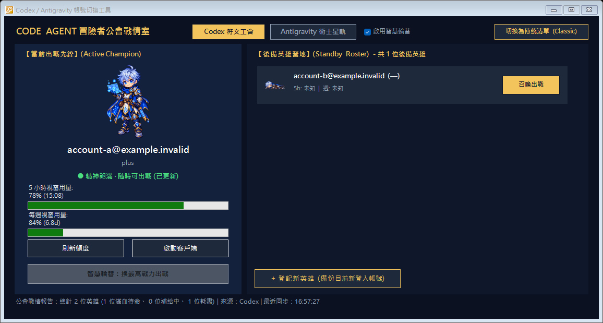
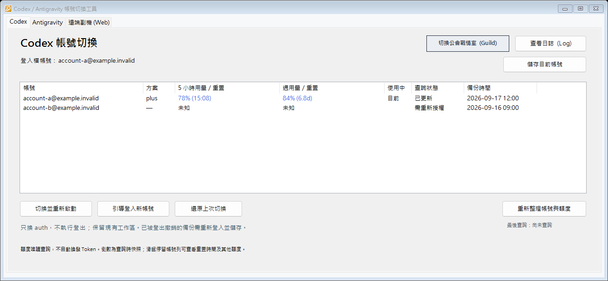
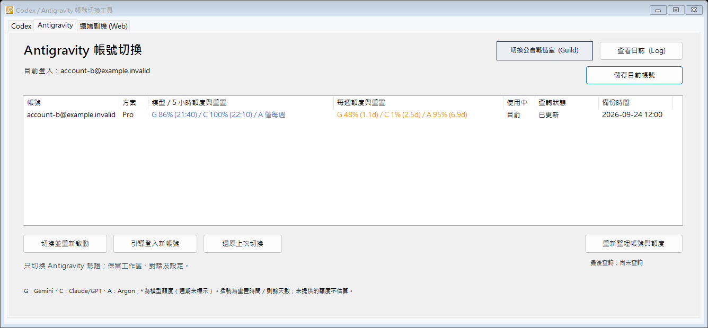
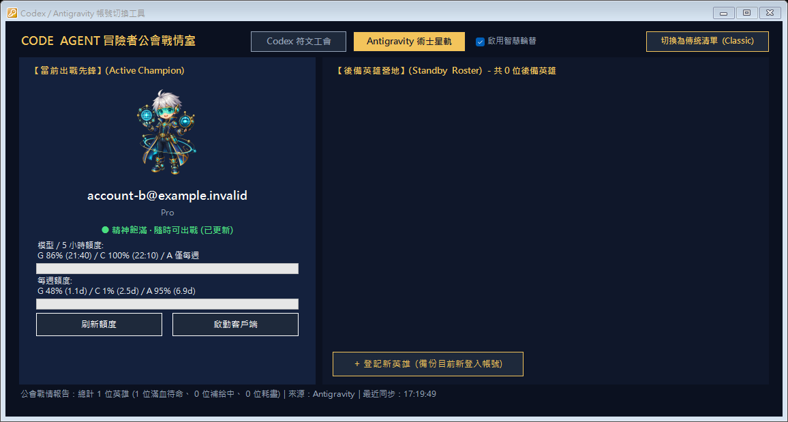
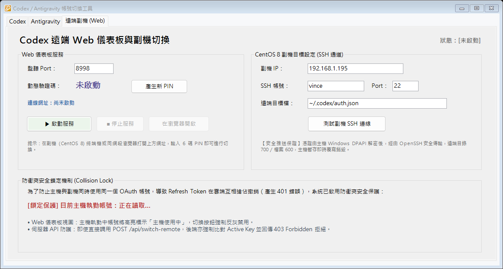

# Codex / Antigravity 帳號切換工具 (CodexAccountSwitcher)

適用於 Windows 的 Codex Desktop 與 Antigravity 2.0 本機帳號切換工具，使用 Windows PowerShell 5.1 與 WinForms，以分頁管理兩套登入。提供加密備份、憑證替換、重新啟動及兩種產品的額度查詢。憑證有效性仍由服務端決定，工具無法恢復已撤銷的登入。

---

## 🌟 核心特色

1. **引導登入**：
   - 呼叫官方 `codex login`，提示將授權網址複製到無痕視窗登入另一帳號。
   - 日常切換只關閉程式並替換認證，不執行登出；已過期或撤銷的備份仍需重新登入並儲存。
2. **工作區與歷史零破壞（Non-Destructive Guarantee）**：
   - Codex 只替換 `auth.json`；Antigravity 只替換 Windows 認證管理員中的 `gemini:antigravity` 項目，並重新啟動對應桌面程式。
   - 不刪除、搬移或重設既有專案、Git worktrees、本機歷史對話、`config.toml`、Antigravity 工作區與應用程式資料庫。
3. **本機高強度安全加密（Windows DPAPI）**：
   - 兩個分頁的已儲存帳號憑證皆以 Windows `ProtectedData` (DPAPI CurrentUser) 加密封裝，分開存放。
   - Codex 同時支援 ChatGPT 訂閱登入與 OpenAI API key；可直接新增金鑰，或備份目前的 API key 登入。金鑰輸入遮蔽，清單僅顯示名稱與雜湊摘要。
   - 每個產品以電子郵件（忽略大小寫及前後空白）識別唯一帳號；同帳號重新登入或儲存只更新同一筆。既有重複備份取最後儲存的一筆顯示及操作，舊檔保留；Codex 未提供電子郵件時沿用原身分識別，避免合併不明帳號。
   - 僅限原登入 Windows 使用者有權解密，即使備份檔被複製到其他電腦亦無法解密還原。
   - 兩個產品皆可刪除已儲存帳號，會清除同帳號的重複備份與相符還原點；不變更目前登入或工作區。
4. **安全隔離檢查閘門（Zero-Credential Security Gate）**：
   - 建置腳本採白名單與憑證特徵掃描；提交前仍需檢查差異，掃描不能保證辨識所有秘密格式。
5. **多種安裝與部署模式**：
   - 提供單一自包含 GUI 安裝程式（`Setup-CodexAntigravitySwitcher.exe`，免 Admin/UAC 權限）。
   - 提供綠色免安裝發行包（`Portable.zip`，內建一鍵捷徑建立與標準解除安裝腳本）。
6. **非同步額度查詢**：
   - Codex 分頁顯示每個已儲存帳號的方案、實際窗口週期、剩餘比例及重置倒數；連線失敗不妨礙本機切換。
   - API key 帳號可分別設定加密保存的 Admin API key、USD 每月預算及重置日期時間，非同步顯示本期已用金額與預算剩餘估算。
   - Antigravity 分頁顯示 Gemini、Claude/GPT、Argon 三種額度及各自的重置時間；兩分頁均只顯示帳號，不重複顯示名稱。過期的存取權杖只在記憶體中刷新，不改寫登入項目或備份。
7. **雙風格介面：傳統清單 vs 冒險者公會戰情室 (Guild Cockpit View)**：
   - **傳統清單模式**：高資訊密度、經典 Windows 表格、支援右鍵選單快速切換與管理。
   - **公會戰情室模式**：視覺化桌面儀表板，將各帳號具象化為英雄幹員（Codex 符文騎士、Antigravity 星軌工匠等），具備精力充沛/疲憊/竭盡等動態像素立繪。
   - **先鋒主將卡片**：醒目展示當前執勤帳號、五小時與週用量雙能量條、即時狀態與重置倒數。
   - **後備名冊卡片流**：水平卡片列出所有後備帳號，點擊任一後備卡片即可立即無縫切換執勤。
   - **智慧輪替控制**：
     - 提供開關核取方塊（可隨時啟用或關閉自動建議）。
     - 單帳號保護：當該來源帳號數 $\le 1$ 時，自動隱藏輪替操作項。
     - 嚴格來源隔離：Codex 僅在 Codex 帳號池間切換；Antigravity 僅在 Antigravity 帳號池間切換，嚴禁跨來源互換。

8. **遠端 Web 儀表板與副機 (CentOS 8) 安全切換**：
   - **可選啟動 Web 服務**：主機啟動後可自由選擇開啟 Web 伺服器，自訂監聽 Port（預設 8998），並自動生成隨機 6 碼動態 PIN 碼。
   - **現代暗色戰情 Web UI**：同區網內任何瀏覽器（或副機桌面）均可開啟 Web 頁面，輸入 6 碼 PIN 解鎖遠端儀表板。
   - **防衝突安全鎖定 (Collision Lock)**：即時識別主機使用中帳號，Web 介面標記為「主機使用中 (鎖定)」並禁用切換；API 端強制攔截，嚴防主副機搶佔同一個 Refresh Token 造成 401 撤銷。
   - **OpenSSH 安全通道派送**：副機端（CentOS 8: 192.168.1.195）零安裝、免常駐服務；主機經由 SSH/SCP 將目標憑證原子覆蓋至副機 `~/.codex/auth.json` 並設為 `chmod 600`。

---

## 📂 專案結構

```text
├── docs/                        # 架構規格、實作計畫與變更歷程
│   ├── implementation_plan/     # 功能與架構實作計畫
│   ├── spec/                    # 規格設計與 API 端點文檔
│   └── walkthrough/             # 歷次功能驗證與問題排除歷程
├── scripts/                     # 自動化建置與發行封裝腳本
│   └── build-installer.ps1      # 零機敏安全檢查閥門與單檔安裝器編譯腳本
├── src/                         # 應用程式核心原始碼
│   ├── CodexAccountSwitcher.ps1 # 主介面與帳號切換核心邏輯
│   ├── AntigravityCredential.ps1 # Antigravity 認證管理員讀寫與備份
│   ├── AntigravityQuota.ps1     # Antigravity 額度查詢與解析
│   ├── CodexBilling.ps1         # API 費用查詢、加密預算設定及每月重置
│   ├── GuildView.ps1            # 冒險者公會戰情室風格介面模組
│   ├── WebDashboard.ps1         # 遠端 Web 儀表板與副機安全派送模組
│   ├── assets/                  # 視覺化資產
│   │   ├── guild/               # 像素英雄角色立繪（透明通道 PNG）
│   │   └── web/                 # 遠端 Web 儀表板自包含單頁應用 (index.html)
│   ├── Launcher.cs              # 靜默無命令提示字元視窗之 C# 啟動器
│   ├── Installer.cs             # 自包含 GUI 安裝精靈原始碼
│   ├── Install.bat              # 免安裝版一鍵安裝捷徑腳本
│   └── Uninstall.bat            # 乾淨解除安裝腳本
├── tests/                       # 自動化測試套件
│   └── Run-SelfTest.ps1         # 核心邏輯自我驗證執行腳本
├── .env.example                 # 環境變數設定範本
├── .gitignore                   # 嚴格機敏資料過濾防護
├── docker-compose.yml           # 容器化審計與測試環境設定
└── README.md                    # 專案詳細說明
```

---

## 🚀 快速開始

### 方式一：使用 GUI 安裝程式（推薦）
1. 執行發行包中的 `Setup-CodexAntigravitySwitcher.exe`。
2. 新版預設安裝至 `%LOCALAPPDATA%\Programs\CodexAntigravitySwitcher`（不需系統管理員權限），不覆寫既有 `CodexAccountSwitcher` 安裝。
3. 安裝完成後將自動在**桌面**與**開始功能表**建立「Codex 與 Antigravity 帳號切換」捷徑。

### 方式二：綠色免安裝版
1. 解壓縮 `CodexAccountSwitcher-v1.3.2-Portable.zip` 至任意資料夾。
2. 點擊 `Install.bat` 即可一鍵建立桌面捷徑；亦可直接點擊 `CodexAccountSwitcher.exe` 立即啟動。

---

## 📖 操作指引

### 雙風格介面切換 (Classic ⇋ Guild)



- **切換至公會戰情室**：點擊任一分頁右上角青色高亮的「**切換公會戰情室 (Guild)**」按鈕，立即展開沉浸式像素英雄戰情面板。
- **切換回傳統清單**：在公會戰情室頂部右上角點擊「**切換為傳統清單 (Classic)**」，隨時返回高資訊密度表格。
- **即時連動**：切換風格不會影響背景的非同步額度查詢排程，兩套介面共享同一資料模型與切換核心。


### Codex 分頁



#### 1. 儲存目前第一個帳號
1. 確認 OpenAI Codex Desktop 已正常登入帳號 A。
2. 開啟「Codex 帳號切換」工具，點擊「**儲存目前帳號**」。工具直接以電子郵件識別帳號，不需另取名稱。

#### 2. 新增或授權第二個帳號（關鍵步驟）
1. 直接在工具內點擊「**引導登入新帳號**」。
2. 確認後工具會保存目前帳號、關閉 Codex，並執行 `codex login`。
3. 複製瀏覽器授權頁的完整網址，手動開啟無痕視窗並貼上；避免為了換帳號而登出既有瀏覽器工作階段。
4. 於無痕視窗登入帳號 B 並完成授權確認。
5. 授權完成後終端機自動關閉，工具捕獲新憑證並加密儲存。

#### 3. 日常切換

Codex 傳統介面分成上下兩個獨立表格：**訂閱帳號**顯示「5 小時用量／重置」及「週用量／重置」；**API key 帳號（USD）**顯示「本期已用金額」及「預算剩餘估算」。兩張表格的選取互斥，切換與刪除按鈕皆操作目前選取的帳號。
1. 在清單中點選目標帳號。
2. 點擊「**切換並重新啟動**」，工具會自動關閉既有 Desktop、保存最新 Token、置換憑證並重啟應用。
3. **智慧啟動偵測**：若 Codex 桌面版尚未啟動，點擊此按鈕將直接以所選帳號權限啟動 Codex，不卡控是否為同一帳號，亦不跳出中斷任務警告。

#### 使用 API key

1. 點「**新增 API key**」，輸入識別名稱與金鑰後儲存。此步驟只建立 DPAPI 加密備份，不改變目前 Codex 登入，也不呼叫 API 驗證金鑰有效性。
2. 若 Codex 已用 API key 登入並將 `OPENAI_API_KEY` 存於 `auth.json`，也可直接點「**儲存目前帳號**」。支援 `auth_mode: "apikey"`，以及未標註模式的舊格式。
3. 選取該筆後使用既有「**切換並重新啟動**」；可在訂閱帳號與 API key 之間切換。相同金鑰重複儲存更新同一筆，不同金鑰分開保存。
4. API key 列顯示「API 計費」；未設定預算時顯示「未設定」。可依下節設定費用查詢，API key 不會送到 ChatGPT 訂閱用量端點，也不會調整 `config.toml` 的模型或 provider 設定；僅存在環境變數中的金鑰需透過「新增 API key」儲存。

公會模式可直接點「**新增 API key**」；Antigravity 不顯示此操作。

#### API key：Admin key、每月預算與費用查詢

1. 在 Codex 清單選取 API key 帳號，點「**API 預算設定**」，填入組織的 **Admin API key**。Admin key 與 Codex 登入金鑰分開以 DPAPI 加密儲存；編輯時不回填明文，留空保留原設定。可由同一視窗移除 Admin key 與預算，帳號本身保留。
2. 選擇查詢範圍。預設「**指定 API key**」，須填 `key_…` 格式的 API key ID（識別碼，不是 `sk-…` 金鑰）；工具不從金鑰原文猜測 ID。也可選「**整個組織**」，統計該 Admin key 所屬組織的全部費用；多個帳號查同一組織時不可把各列再相加。
3. 設定 **每月預算（USD）**、**重置日（1～31）**與 **時間（HH:mm）**。預設每月 1 日 00:00，採設定時的本機時區。短月不足指定日則採月底，下月恢復原日期；夏令時間跳過的時刻順延至有效時間，重複時刻採標準時間。
4. 儲存或點「重新整理帳號與額度」後，在獨立的 **API key 帳號（USD）** 表格顯示 **本期已用金額**與 **預算剩餘估算**。例如：`USD 12.34`、`估 USD 87.66 (87.7%)`。超支保留負數金額，滑鼠停留可查看本期起訖、查詢範圍、時區與預算。API 預算設定須選取該表格中的帳號；公會及 Web 視圖同步使用相同金額標題，保留兩類帳號。

「本期」由自訂的每月重置時刻起算，不一定是曆月。工具開啟期間到達重置時刻會自動重新查詢；關閉後再開啟也會依目前時間換期，不累積前期預算。這只調整本機估算，不變更 OpenAI 的帳務週期、預算或實際儲值餘額，也不會強制停止 API 使用。

查詢只向官方 [`GET /v1/organization/costs`](https://developers.openai.com/api/reference/resources/admin/subresources/organization/subresources/usage/methods/costs) 傳送 Admin key，完整加總所有分頁的 USD 費用。官方費用按日彙總且可能延遲；若回傳日窗口跨越設定的重置時刻，已用金額會加註「約」，不能保證分鐘級精準。查詢失敗、權限不足、格式不支援或分頁未完整時顯示未知，不假設為零費用。一般 API key 與 Admin key 不互相替代；Admin key 不會寫入 `auth.json`、Web 回應或副機派送內容。刪除帳號時會一併移除其 Admin key 與預算設定。

查詢結束時間採「查詢當日的下一個 UTC 零點」，以納入完整的當日費用窗口。1.3.2 修正原先以目前時間作為結束時間而漏查當日費用的問題；回傳金額仍是查詢當下已回報的費用。工具依自訂重置週期統計，與 OpenAI 後台的曆月支出比較時，須對齊日期範圍。

#### 4. 額度與重置時間

開啟工具或點擊「重新整理帳號與額度」會在背景查詢已儲存帳號。因欄位標題已明確標示「5 小時用量」與「週用量」，資料行不再重複標記 `5h` 與 `7d`：
- **5 小時用量**：顯示重置時間點，例如 `78% (15:08)`（跨日則顯示 `MM/dd HH:mm`）。
- **週用量**：剩餘時間小於 12 小時改顯示重置時間點；大於等於 12 小時保持顯示倒數，例如 `84% (6.8d)` 或 `50% (15h00m)`。
時間與倒數均為查詢時快照，重新整理可更新。滑鼠停留帳號列可查看查詢時間、本地重置時間及其他額度（含實際 5h、7d 週期）。

按鈕下方顯示本輪查詢完成時間。剩餘額度以顏色區分：0% 紅色、低於 30% 黃色、低於 70% 綠色、70% 以上藍色；未知額度維持灰色。

週剩餘額度為 0% 時，5 小時剩餘額度同步顯示為 0% 且倒數改顯示為 `-`（例如 `0% (-)`），反映週上限已阻止繼續使用。

缺少資料顯示「未知／未提供」。401 顯示「需重新授權」，不代表一定可刷新；403 為存取受限，429 請稍後重試。請求逾時為 3 秒。查詢不會執行登入、登出、Token 換發或覆寫備份。

用量查詢會將該帳號 Access Token 傳送至 OpenAI 的 `chatgpt.com/backend-api/wham/usage`，不經中繼伺服器。這是內部端點，日後可能變更或無法使用；不影響本機備份與切換。

### Antigravity 分頁



> [!TIP]
> **公會戰情室視圖**：亦可於右上角隨時切換為「Antigravity 術士星軌」沉浸式英雄戰情面板：
>
> 

1. 在 Antigravity 2.0 桌面版登入後，於此分頁按「儲存目前帳號」。備份存於 `%LOCALAPPDATA%\CodexAntigravitySwitcher\antigravity`，僅原 Windows 使用者可解密。
2. 點「引導登入新帳號」：工具先備份目前認證，關閉 Antigravity，清除本機登入項目，再啟動官方登入畫面。請在瀏覽器登入另一帳號，返回工具確認後會自動儲存。不要在 Antigravity 按 Sign Out；取消或未偵測到新帳號時，工具會嘗試還原原認證。
3. 從清單選取帳號後按「切換並重新啟動」。工具會要求先結束執行中任務，關閉桌面版並自動終止殘留語言服務與子程序，確認全部結束後只替換 `gemini:antigravity` 認證項目並重新啟動。完成後請在 Account 頁確認實際登入；失敗時可按「還原上次切換」。

登入資料同時支援舊版 `id_token` 與本機 Antigravity 2.28.2 觀察到的 `id_token_email` 格式；兩者沿用相同的電子郵件帳號識別，既有加密備份仍可使用。若舊版切換器顯示「登入資料格式不支援或已損壞」，請更新切換器後重新開啟。

Antigravity 分頁以 `G` 表示 Gemini、`C` 表示 Claude/GPT、`A` 表示 Argon，三組額度分開計算。五小時／模型欄顯示 `比例 (重置時間)`，每週欄依 Codex 相同規則顯示重置時間或剩餘天數；滑鼠停留可查看完整本地時間。摘要優先；缺少摘要時取該組模型的最低剩餘比例，並使用同一模型的重置時間，以 `G*`、`C*`、`A*` 標示來源。模型回應未標明週期，不宣稱為固定五小時額度，也不推算每週額度。Argon 摘要使用 `gemini-argon-wtu-weekly`，屬獨立每週額度，顯示於每週欄；五小時欄標示「A 僅每週」，不把同一週額度再當成五小時額度。缺漏顯示「未提供」，查詢狀態為「已更新／部分額度」；各組保留每週歸零保護。倒數為查詢時快照，重新整理可更新。

額度直接使用帳號的存取權杖向 Google `daily-cloudcode-pa.googleapis.com/v1internal:retrieveUserQuotaSummary` 查詢；方案使用 `loadCodeAssist`。請求的 `User-Agent` 使用桌面版 `hub` 識別，帶入已安裝 `Antigravity.exe` 的檔案版本及 Windows 架構（`antigravity/hub/<版本> windows/<架構>`）；本機對照實查確認，缺少 `hub` 會使服務省略 Argon。每次額外呼叫同一主機的 `fetchAvailableModels` 以偵測 Argon；即使 Gemini／Claude 摘要完整也不略過。Argon 模型與一般 Gemini 隔離，只採明確回傳且介於 0 至 1 的 `quotaInfo.remainingFraction` 與對應 `resetTime`，不將缺漏資料補為 100%。過期時使用備份內的刷新權杖與已安裝 Antigravity 程式中的 OAuth 用戶端設定，在記憶體中取得新存取權杖。此流程不需 CLI，也不修改備份或目前登入。這些是 Antigravity 內部端點與程式設定，版本更新後可能改變；查詢失敗會顯示狀態，不影響切換。四個真實備份帳號已驗證 Gemini 與 Claude/GPT 的五小時及每週額度；改用 `hub` 識別後，其中三個帳號已取得真實 Argon 每週比例及重置時間，另一帳號未回傳。兩個真實帳號也已驗證免瀏覽器重登切換與引導登入，工作區及對話仍保留。

新版首次啟動會驗證 `%LOCALAPPDATA%\CodexAccountSwitcher` 的舊版 Codex 加密備份，將尚未存在的帳號複製到 `%LOCALAPPDATA%\CodexAntigravitySwitcher`。舊版原件保留；若新版已有同一帳號的備份，不覆寫新版資料。桌面與開始功能表捷徑使用舊版相同的金鑰圖示。

若需在不讀取已安裝版 Codex 帳號的情況下測試 Antigravity，可從原始碼以 `-IsolatedAntigravityTestPath` 指定獨立資料目錄；此模式會停用 Codex 分頁，Antigravity 仍使用目前 Windows 使用者的真實登入項目。

### 刪除已儲存帳號（Codex／Antigravity）

在對應產品的傳統清單選取帳號，點「**刪除已儲存帳號**」，確認後刪除。公會模式可由「**管理／刪除帳號**」回到對應清單操作。

- 刪除新版工具內該帳號的全部可驗證備份（包含隱藏的舊識別重複檔），以及當下相符的切換還原點；其他帳號、產品及無法識別的損壞備份保留。
- 不登出、不撤銷 API key 或 Token，不刪除目前 `auth.json`、Antigravity 登入認證、工作區、對話或設定。刪除目前使用中的帳號也適用。
- 保存不含憑證的 `.deleted` 標記，避免重啟時從舊版原件再次匯入，或切換時自動重新加入帳號。舊版工具的原件不刪除；需要重新加入時，可明確儲存目前帳號或重新新增 API key。
- 刪除後同步更新 Web 清單與記憶體中的可派送憑證；已在其他電腦安裝的認證不受影響。

### 遠端副機 (Web 儀表板) 分頁



1. **啟動 Web 儀表板**：
   - 切換至「**遠端副機 (Web)**」分頁（或在 Codex 分頁點擊「🌐 遠端副機 / Web」快速跳轉）。
   - 設定監聽 Port（預設 `8998`），點擊「**▶ 啟動 Web 儀表板**」。
   - 工具會自動生成一組 6 碼隨機動態驗證碼（例如 `839201`），並顯示服務網址（例如 `http://192.168.1.168:8998`）。
2. **副機 SSH 連線設定**：
   - 預設目標副機為 `192.168.1.195`、SSH 帳號 `vince`、連接埠 `22`、目標路徑 `~/.codex/auth.json`。
   - 點擊「**⚡ 測試副機 SSH 連線**」可即時驗證免密碼金鑰通道是否就緒。
3. **遠端瀏覽器切換操作**：
   - 在 CentOS 8 或同網段任意裝置的瀏覽器開啟 `http://192.168.1.168:8998`。
   - 輸入主機顯示的 6 碼 PIN 解鎖戰情儀表板。
   - **防衝突保護**：正在主機執勤中的帳號會自動顯示 `🔒 主機使用中（鎖定保護）`，切換按鈕強制反灰禁止點擊。
   - 點選其他任一後備帳號的「🚀 切換至 CentOS 副機」，主機即刻經由 SSH 安全通道將解密後之 `auth.json` 推送至副機並原子覆蓋。

---

## 🧪 自我驗證與測試

執行測試腳本可驗證加密、備份、Token 更新、原子置換與工作區保護。Antigravity 測試會在 Windows 認證管理員短暫建立並刪除隨機命名的合成項目，不讀寫真實憑證；需在正常 Windows 使用者登入工作階段執行：

```powershell
powershell.exe -NoProfile -ExecutionPolicy Bypass -File .\tests\Run-SelfTest.ps1
```

---

## 🔒 資安宣告（Security Policy）

* 本專案遵循 **Zero-Credential Policy**，原始碼與版本控制歷史中**絕不包含**任何真實使用者權杖 (`auth.json`)、DPAPI 加密金鑰檔 (`*.bin`)、個人電子郵件或操作日誌 (`*.log`)。
* 帳號切換於本機進行原子檔案置換；額度查詢直接連線 OpenAI，不架設中繼伺服器。備份與工作區不會因查詢失敗而刪除。

---

## 📄 授權條款

MIT License.
