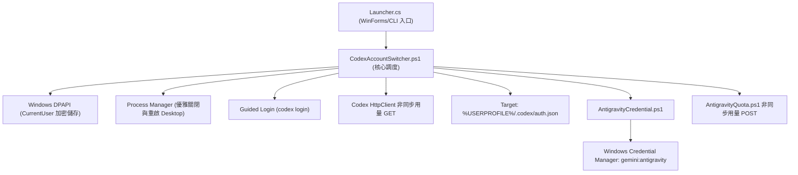

# Codex／Antigravity 帳號切換工具 - 系統架構與規格設計 (System Specification)

## 1. 架構目標
本工具在 Windows 上以 Codex 與 Antigravity 分頁提供本機帳號切換。兩個分頁只處理各自的認證；原有工作區與對話保持原位。

---

## 2. 核心架構與組件劃分

### 2.1 模組職責
1. **啟動器 (`Launcher.cs`)**：
   - 使用 .NET Framework 原生編譯為 `CodexAccountSwitcher.exe`。
   - 以 `-WindowStyle Hidden -ExecutionPolicy Bypass` 靜默拉起 PowerShell，消除黑底命令提示字元視窗。
2. **切換調度器 (`CodexAccountSwitcher.ps1`)**：
   - 負責帳號備份讀取、還原點維護、程序識別與原子覆寫。
3. **引導授權 (`Start-GuidedLogin`)**：
   - 調用 `codex login`，提示使用者複製授權網址到無痕視窗登入。
   - 不保證登入永遠有效；已撤銷的備份需重新登入。
4. **安裝精靈 (`Installer.cs`)**：
   - 自包含單檔 GUI 安裝器，負責檔案解包、桌面捷徑與開始功能表建立、Windows 應用程式清單註冊。
5. **Antigravity 認證 (`AntigravityCredential.ps1`)**：
   - 僅讀寫 Generic Credential `gemini:antigravity`，支援舊版 `id_token` 與新版 `id_token_email` 身分格式，並以 DPAPI 儲存各帳號備份。
   - 先正常關閉 Antigravity 2.0 桌面版，再強制結束殘留桌面程序、相同安裝目錄的語言服務（含孤兒服務）與子程序；以 PID 及建立時間辨識原有程序，避免誤關 PID 重用後的其他程序。確認全部退出後才替換認證並讀回驗證，驗證成功後重新啟動；認證替換失敗時回寫切換前認證。其他 CLI／IDE 執行時仍阻止切換。
   - 引導新增帳號時先備份目前認證，停止桌面版、清除本機認證，再啟動官方登入；確認新身分後儲存。取消或未完成時還原原認證。
   - 不替換 `%APPDATA%\Antigravity`、`~/.gemini/antigravity` 或任何工作區、對話資料庫。
6. **Antigravity 額度 (`AntigravityQuota.ps1`)**：
   - 以已儲存帳號的存取權杖查詢 Gemini、Claude/GPT、Argon 三組額度與方案；每次查詢模型以偵測 Argon，摘要優先，缺少時以同組模型補充，明示來源及未提供的視窗。
   - 存取權杖過期時，僅在記憶體中以刷新權杖換發；OAuth 用戶端設定取自已安裝的 Antigravity 程式，不寫入原始認證或備份。

---

## 3. 安全規格與邊界 (Security Boundary)

| 安全領域 | 設計規範 |
| :--- | :--- |
| **憑證儲存** | 新版儲存於 `%LOCALAPPDATA%\CodexAntigravitySwitcher\*.bin`，採 DPAPI CurrentUser 加密；啟動時驗證並複製缺少的舊版備份，保留舊版原件且不覆寫新版同名備份。 |
| **機敏隔離** | 嚴格禁止將任何真實 Token、API Key、個人郵件納入發行包或版本控制。 |
| **原子寫入** | 憑證替換使用 `Write-Atomic`（同目錄臨時檔寫入 + Replace/Move），確保斷電不損毀。 |
| **還原機制** | 每次切換前自動產生 `last-switch.rollback`，異常時自動回滾。 |
| **Antigravity 備份** | 存於 `%LOCALAPPDATA%\CodexAntigravitySwitcher\antigravity\*.bin`；Codex 與 Antigravity 的備份及還原點分開。 |
| **Antigravity 實證邊界** | 合成認證測試及兩個真實帳號的免重登切換、引導登入已通過；版本或登入格式變更後需重驗。 |
| **獨立測試** | `-IsolatedAntigravityTestPath` 將備份及日誌放在指定目錄，停用 Codex 分頁並避免讀取既有 Codex 登入檔；Antigravity 認證目標仍為目前使用者的真實項目。 |

新版安裝目錄、捷徑與 Windows 解除安裝項目另設名稱，與既有 `CodexAccountSwitcher` 安裝並存。執行中的 Codex 視窗仍使用相同單一實例鎖，避免兩套工具同時切換同一個 `auth.json`。
新版桌面與開始功能表捷徑沿用舊版的 `shell32.dll,44` 金鑰圖示。

## 4. 帳號唯一性

各產品分別以正規化電子郵件（去除前後空白並轉小寫）計算帳號識別鍵，不以每次登入的 `sub` 或所選工作區建立新資料。Codex 未提供電子郵件時沿用 `sub + account_id` 識別；兩個產品的帳號池仍分開。

Codex 另支援 `auth_mode: "apikey"` 搭配非空白字串 `OPENAI_API_KEY`，以及未標註模式的 API key 格式；拒絕混用訂閱 Token 的 API key 資料。API key 以 `SHA256("apikey:" + key)` 作唯一識別，不和訂閱帳號合併。清單顯示自訂名稱與雜湊摘要，不顯示金鑰原文；直接新增時以密碼欄位輸入，使用原有 DPAPI 備份格式，不改寫目前登入。原子切換與還原沿用現有 `auth.json` 路徑；不修改 provider 或模型設定。格式依 [Codex 官方認證儲存定義](https://github.com/openai/codex/blob/main/codex-rs/login/src/auth/storage.rs)，並以本機 CLI 隔離登入的合成金鑰確認。

舊版備份讀取時仍驗證原識別鍵，再映射至新鍵。共用的 `Get-AccountBackups` 按新鍵彙整，取最後儲存的一筆；同秒優先使用新鍵檔名的備份，其餘以路徑固定排序。傳統清單、公會視圖、額度查詢與 Web 清單使用同一份唯一帳號資料，目前帳號標記與 Web 主機鎖定亦使用新鍵。舊原檔及還原點保留，不因去重而刪除。

重新儲存固定覆寫新鍵對應的備份檔，自動備份延續既有自訂名稱。舊版匯入按帳號識別避免重複，首次匯入同帳號僅選最後儲存的一筆；不覆寫新版既有帳號。

### 4.1 刪除已儲存帳號

兩個傳統清單皆提供刪除按鈕，公會視圖提供返回對應清單的管理入口。確認預設選「否」。`Remove-AccountBackup` 僅接受所選產品備份目錄內的 `.bin`，讀取驗證身分後，掃描該目錄的全部備份，刪除相同正規化識別的所有可驗證檔案與相符 `last-switch.rollback`；不追蹤連結檔案，也不刪除不明身分的損壞檔。

刪除前以原子寫入建立 `<Key>.deleted` 標記（內容不含憑證）。舊版 Codex 自動匯入與兩產品的自動備份會略過此識別；明確儲存成功後移除標記。舊版工具原件保留。刪除不修改目前登入、程序、工作區或設定；後續切換仍依原有安全機制建立當次還原點。刪除完成重新整理清單並取消舊額度請求，Web 同步移除記憶體中的憑證，即使刪除最後一筆也回傳 `[]`。

## 5. 唯讀額度查詢

Codex 的 `QuotaClient.Fetch` 使用 .NET HttpClient 非同步 GET，WinForms Timer 收取已完成 Task。目標限定 `https://chatgpt.com/backend-api/wham/usage`，不跟隨重新導向、無 Cookie、3 秒逾時、回應上限 256 KiB。僅回傳狀態及成功 JSON，錯誤本文與例外內容不寫入日誌。

Codex 目前帳號使用最新登入檔，其他帳號使用現有加密備份；查詢不刷新或回寫認證。Antigravity 目前帳號使用認證管理員中的登入，其他帳號使用加密備份；非同步 POST 至 Google Cloud Code 的 `retrieveUserQuotaSummary`，必要時向 Google OAuth 換發短期權杖，並以 `loadCodeAssist` 查方案。結果依帳號 Key 及查詢世代更新，重新整理、切換／登入／還原、關閉視窗取消舊請求。三組模型的額度同列顯示，括號內顯示重置時間／剩餘天數，列提示提供完整本地時間。兩分頁移除名稱輸入與名稱欄，清單、公會及 Web 直接顯示電子郵件；既有備份的名稱中繼資料仍可讀取。

Codex API key 不建立訂閱額度查詢 Task，查詢入口亦檢查認證類型，避免將金鑰傳送至 ChatGPT 用量端點；未設定預算時方案欄顯示 `API key`、狀態為「API 計費」，兩個費用欄顯示「未設定」。API 金鑰的有效性與真實桌面推論需另行驗證，儲存時不呼叫付費 API。

### 5.1 API 費用及預算估算（CodexBilling.ps1）

- 每筆 API key 帳號的設定獨立存於 `billing/<Key>.bin`，內容為帳號識別、Admin key、USD 預算、每月重置日／時／分、設定時的 Windows 本機時區及查詢範圍，整筆以 DPAPI CurrentUser 加密。Admin key 不放入一般帳號備份、`auth.json` 或 Web／SSH 資料；編輯時不回填明文，可獨立移除，刪除帳號時一併刪除設定。
- 預設以使用者指定的 `key_…` API key ID 篩選，送出 `api_key_ids[]` 與 `group_by[]=api_key_id`；收到不同金鑰識別的結果即拒絕。亦可明確選擇整個組織，UI 狀態與提示會標示組織範圍，避免將其他金鑰成本誤認為單一金鑰費用。
- `Get-CodexBillingPeriod` 依儲存時區計算 `[本期重置時刻, 下期重置時刻)`；29～31 日遇短月採月底，下月恢復原日。夏令時間無效時刻順延，重複時刻採標準時間。每月邊界由不同月份各自計算，避免二月截日後永遠停留 28 日。WinForms Timer 到達下期邊界時重新整理，開啟程式時依當時時間重算。
- `BillingClient.Fetch` 只 GET `https://api.openai.com/v1/organization/costs`，以 Admin key 認證，傳送本期起點、`bucket_width=1d` 及 `limit=180`。`Get-CodexBillingQueryEnd` 以查詢時間計算下一個 UTC 零點，供 HTTP 的 `end_time` 與回應範圍驗證共用，避免漏掉當日 bucket；原查詢時間仍用於提示中的時間快照。禁止重新導向與 Cookie，單頁逾時 5 秒、上限 1 MiB。游標編碼後逐頁查詢，最多 10 頁且拒絕重複游標，末頁完成才顯示總數。
- 費用以 decimal 加總；接受有效空陣列為零，但缺少金額、非 USD、錯誤範圍、分頁失敗與 HTTP 錯誤均顯示未知。預算剩餘＝設定預算－本期已用，金額可為負值，比例限制在 0～100%。這是本機軟性預算估算，不是 OpenAI 餘額或強制使用限制。官方日彙總跨越本期起點時，已用金額加註「約」；費用延遲與日彙總限制於提示中明示。
- 與訂閱用量共用查詢工作、取消權杖及世代隔離；換期、重新整理、切換或關閉時取消舊結果。傳統清單、公會及 Web 使用 API 費用標題，不將金額誤標為五小時／每週額度。HTTP 錯誤本文與例外詳情不進入 UI 或日誌。
- Codex 傳統介面以兩張獨立表格顯示：訂閱帳號保留五小時／週額度，API key 帳號使用「本期已用金額」及「預算剩餘估算」。重新整理按認證類型分派資料，非同步回應按工作類型與帳號識別更新所屬表格。兩表選取互斥，切換及刪除讀取目前選取項目，預算設定僅接受 API key 表格的選取。`Get-CodexAccountItems` 合併兩表項目供公會與 Web 使用，不改變備份格式、查詢週期或費用計算。

合成資料與模擬 HTTP 驗證涵蓋加密設定、跨月／跨年／閏年／重置時刻、UTC 當日費用窗口、費用篩選與分頁、超支與未知資料、取消及 WinForms 儲存／保留原金鑰／移除設定。

2026-11-15 唯讀實查確認：以同一 Admin key 比對日期範圍，採用下一個 UTC 零點作為結束時間後，當日費用會被納入，與後台同範圍支出相符。原查詢漏掉當日費用，不能只解釋為帳務延遲。自訂週期與後台曆月期間仍須分開對帳；實查不變更登入、金鑰設定或帳務。

額度、方案與模型請求共用 `antigravity/hub/<版本> windows/<架構>` 的 `User-Agent`，與桌面版的 `--subclient_type hub` 識別對齊。版本從 `language_server.exe` 所在 `resources/bin` 目錄向上定位 `Antigravity.exe`，讀取檔案版本；未能讀取時保留 `antigravity/hub windows/<架構>`。原生字串含多個斜線，使用 `TryAddWithoutValidation` 加入固定格式標頭，避免 .NET 產品語法解析器拒絕。相同帳號、API 與本文的對照實查確認：缺少 `hub` 時只回傳 Gemini／Claude，加上後即回傳 Argon。

每次以同一存取權杖呼叫 `fetchAvailableModels`，有 `cloudaicompanionProject` 時一併帶入。忽略停用欄位或 `-disabled`／`_disabled` 結尾的占位模型；先依模型 ID 或顯示名稱辨識 Argon，再篩選 `tieredModelIds` 指定的一般 Gemini 語言模型，避免把 Argon 混入 Gemini。各組取明確提供且介於 0 至 1 的 `quotaInfo.remainingFraction` 最低值，重置時間沿用該模型的 `resetTime`，以 `G*`／`C*`／`A*` 標示。模型回應未標明週期，不宣稱為五小時額度，也不推算週額度；缺漏顯示「未提供」，狀態標記「已更新／部分額度」。查詢錯誤、取消或格式損壞不覆蓋已取得的摘要。

傳統清單及公會視圖以 G／C／A 顯示三組資料。重置格式共用 Codex 的 `Format-QuotaWindow`：五小時／模型額度顯示本地重置時間，週額度少於 12 小時顯示時間，其他顯示剩餘時數或天數；缺少時間時明示未知。同組週額度歸零時，同組主要額度同步標示耗盡。真實 Argon bucket 為 `gemini-argon-wtu-weekly`，映射為獨立每週窗口；有此摘要且未提供 Argon 五小時窗口時，五小時欄標示「A 僅每週」，不再使用同一模型週額度填入主要窗口。完整 Gemini／Claude 四窗口加 Argon 每週窗口即標為「已更新」。hub 標頭、真實 bucket、每週歸零與各模型來源隔離、非同步更新及取消已通過合成測試；本次經使用者授權唯讀查詢 4 個去重後的備份帳號，修正後有 3 個成功取得真實 Argon 每週比例與重置時間，另一個未回傳。未切換帳號或回寫憑證／備份。

Codex 欄位與驗證方式見 [額度查詢計畫](../implementation_plan/quota_display.md)。兩產品的額度端點都屬內部介面，查詢失敗不阻擋帳號切換。
